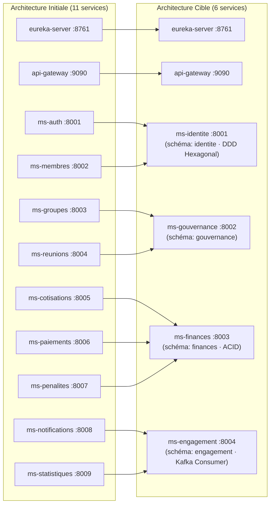

1# Plan d'Architecture & de Migration — Consolidation 9 → 4 Microservices

> **Statut :** **Migration complète terminée** — Phase 1 (Documentation), Étape 2.1 (Consolidation 9 → 4 microservices), Étape 2.2 (**Java 25 / Spring Boot 4.0.10**) et Étape 2.3 (Unification `shared/` & branchement réel Web + Mobile sur l'API Gateway) **validées**.  
> **Objectif :** Réduire la fragmentation backend de **11 services Spring Boot à 6** (**4 microservices métier + Eureka Server + API Gateway**), fiabiliser la cohérence transactionnelle et événementielle, sécuriser les API, et préparer la montée **Java 25 / Spring Boot 4**.

---

## 1. Pourquoi consolider maintenant ?

L'audit du dépôt initial (9 microservices métier + Gateway + Eureka) a mis en évidence 5 problèmes structurels :
1. **Empreinte mémoire excessive sur LuxVps** : 11 JVMs Spring Boot + PostgreSQL + Kafka sur un serveur dédié low-cost consomment inutilement RAM et CPU.
2. **Couplage transactionnel cassé** : `ms-paiements`, `ms-cotisations` et `ms-penalites` manipulent le même flux financier (un paiement validé doit solder la cotisation correspondante ; un retard doit générer une amende), mais étaient séparés sans saga ni consommation mutuelle fiable.
3. **Désalignement des topics Kafka** :
   - `ms-penalites` publiait sur `sanction.events` tandis que `ms-notifications` et `ms-statistiques` écoutaient `penalite.appliquee`.
   - `ms-groupes` publiait sur `groupe.events` tandis que `ms-notifications` écoutait `groupe.cree`.
   - `ms-cotisations` publiait sur `cotisation.events` tandis que `ms-notifications` écoutait `cotisation.retard`.
4. **Sécurité JWT non appliquée** : `api-gateway` avait `.anyRequest().permitAll()` et tous les microservices ouvraient `/api/v1/**` sans validation de jeton ni contrôle de rôle.
5. **Coût de maintenance élevé** : 9 configurations `SecurityConfig`, `GlobalExceptionHandler`, `OpenApiConfig`, `KafkaConfig`, `Dockerfile` et `application.yml` dupliqués (avec déjà des dérives sur `ms-notifications` et `ms-statistiques`).

---

## 2. Cartographie de Consolidation (Avant → Après)



### Détail de chaque service cible

| Service cible | Port | Schéma PostgreSQL | Modules fusionnés | Style d'architecture |
|---|---:|---|---|---|
| `eureka-server` | `8761` | — | `eureka-server` | Serveur de découverte Netflix Eureka |
| `api-gateway` | `9090` | — | `api-gateway` | Spring MVC + Virtual Threads + `@LoadBalanced` Eureka + OAuth2 Resource Server JWT |
| `ms-identite` | `8001` | `identite` | `ms-auth` + `ms-membres` | **Hexagonale & DDD pur** (`domain/`, `application/`, `infrastructure/`) |
| `ms-gouvernance` | `8002` | `gouvernance` | `ms-groupes` + `ms-reunions` | En couches par sous-module (`groupe/`, `session/`, `mandat/`, `reunion/`, `presence/`) |
| `ms-finances` | `8003` | `finances` | `ms-cotisations` + `ms-paiements` + `ms-penalites` | En couches par sous-module (`cotisation/`, `pot/`, `paiement/`, `penalite/`) avec transactions ACID |
| `ms-engagement` | `8004` | `engagement` | `ms-notifications` + `ms-statistiques` | En couches (`notification/`, `statistique/`) + projection CQRS depuis Kafka |

---

## 3. Rétrocompatibilité des Routes API Gateway (Zéro Breaking Change)

Les clients (`njanki/`, `njanki-mobile/`, scripts E2E, Postman) continuent d'appeler exactement les mêmes URLs `/api/v1/*` via `api-gateway` (`:9090`) :

| Route publique Gateway | Service Eureka cible | Contrôleur interne | Auth JWT requise |
|---|---|---|---|
| `/api/v1/auth/**` | `lb://ms-identite` | `AuthController` | Non (sauf `/me`, `/social/lier-telephone`) |
| `/api/v1/membres/**` | `lb://ms-identite` | `MembreRestController` | Oui |
| `/api/v1/groupes/**` | `lb://ms-gouvernance` | `GroupeController`, `SessionTontineController`, `MandatBureauController` | Oui |
| `/api/v1/reunions/**` | `lb://ms-gouvernance` | `ReunionController` | Oui |
| `/api/v1/cotisations/**` | `lb://ms-finances` | `TypeCotisationController`, `CotisationController`, `PotSessionController` | Oui |
| `/api/v1/paiements/**` | `lb://ms-finances` | `PaiementController` | Oui (sauf `/webhooks/{operateur}` signé HMAC) |
| `/api/v1/penalites/**` | `lb://ms-finances` | `PenaliteController`, `TarificationController` | Oui |
| `/api/v1/notifications/**` | `lb://ms-engagement` | `NotificationController` | Oui |
| `/api/v1/statistiques/**` | `lb://ms-engagement` | `StatistiqueController` | Oui |

---

## 4. Contrat Kafka Unifié (4 Topics)

Fini les noms de topics éparpillés et non alignés. Chaque microservice émet sur **son unique topic de domaine** avec une enveloppe standardisée :

```java
public record DomainEvent(
    UUID eventId,
    String eventType,      // ex: "PAIEMENT_VALIDE", "BUREAU_ELU"
    String sourceService,  // ex: "ms-finances"
    UUID groupeId,
    UUID acteurId,
    Instant occurredAt,
    Map<String, Object> payload
) {}
```

| Topic Kafka | Producteur | Événements (`eventType`) | Consommateurs |
|---|---|---|---|
| `identite.events` | `ms-identite` | `OTP_DEMANDE`, `UTILISATEUR_INSCRIT`, `UTILISATEUR_CONNECTE`, `MEMBRE_INSCRIT`, `ROLE_ASSIGNE` | `ms-engagement` (SMS OTP, welcome, compteur membres) |
| `gouvernance.events` | `ms-gouvernance` | `GROUPE_CREE`, `MEMBRE_AJOUTE`, `SESSION_DEMARREE`, `SESSION_CLOTUREE`, `BUREAU_ELU`, `REUNION_DEMARREE`, `REUNION_TERMINEE` | `ms-engagement` (convocations, PV, assiduité), `ms-identite` (synchro rôle membre/démotion créateur) |
| `finances.events` | `ms-finances` | `COTISATION_PAYEE`, `COTISATION_RETARD`, `PAIEMENT_VALIDE`, `PAIEMENT_REJETE`, `POT_ATTRIBUE`, `POT_VERSE`, `SANCTION_INFLIGEE`, `SANCTION_PAYEE` | `ms-engagement` (alertes Push/SMS/Email, bilans Cash vs MoMo) |
| `engagement.events` | `ms-engagement` | `NOTIFICATION_ENVOYEE`, `NOTIFICATION_ECHEC`, `BILAN_GENERE` | Audit / observabilité |

> **Gain majeur dans `ms-finances` :** La validation d'un paiement (`PaiementService`) met à jour la cotisation associée (`CotisationService`) dans la **même transaction `@Transactional`** (ACID), sans risque d'état incohérent si Kafka est momentanément indisponible. De même, le marquage d'un retard de cotisation crée directement la pénalité correspondante selon le barème du groupe.

---

## 5. Stratégie Base de Données & Migrations Flyway

PostgreSQL conserve une **instance unique** mais passe de **9 schémas à 4 schémas isolés** :

| Schéma cible | Tables regroupées | Migration initiale |
|---|---|---|
| `identite` | `utilisateurs`, `token_otp`, `membres`, `membre_groupes` | `V1__init_identite.sql` |
| `gouvernance` | `groupes`, `groupe_membres`, `sessions_tontine`, `mandats_bureau`, `reunions`, `presences` | `V1__init_gouvernance.sql` |
| `finances` | `types_cotisation`, `cotisations`, `pots_session`, `paiements`, `tarifications_penalite`, `penalites` | `V1__init_finances.sql` |
| `engagement` | `notifications`, `statistiques_groupe` | `V1__init_engagement.sql` |

**Règles strictes :**
- `spring.jpa.hibernate.ddl-auto: validate` sur **tous** les services (y compris `ms-engagement`, corrigeant l'ancien `ddl-auto: none`).
- Credentials homogènes (`njangi` / `njangi_secret` en dev local, injectés par variables d'environnement en production).
- Correction de l'indentation `eureka.instance.prefer-ip-address: true` sur tous les `application.yml`.

---

## 6. Durcissement Sécurité (Correction des failles identifiées)

1. **`api-gateway`** :
   - Activer `.oauth2ResourceServer(oauth2 -> oauth2.jwt(Customizer.withDefaults()))` dans `SecurityConfig`.
   - Protéger toutes les routes sauf `/api/v1/auth/inscrire`, `/api/v1/auth/login`, `/api/v1/auth/otp/**`, `/api/v1/auth/social/login`, `/api/v1/paiements/webhooks/**`, `/actuator/health`.
   - Propager les claims vérifiés (`X-User-Id`, `X-User-Phone`, `X-User-Email`) vers les microservices en aval et purger tout header spoofé entrant.
   - Remplacer `RestTemplate` statique par un `RestClient` / `RestTemplate` `@LoadBalanced` résolvant `lb://ms-identite`, `lb://ms-gouvernance`, `lb://ms-finances`, `lb://ms-engagement` via Eureka.
2. **Microservices métier** :
   - Validation de l'identité propagée / JWT Resource Server.
   - Vérification des rôles métier par groupe (`PRESIDENT`, `TRESORIER`, `SECRETAIRE`, `CREATEUR`).
   - Suppression des secrets JWT par défaut codés en dur (obligation de définir `NJANGI_JWT_SECRET` hors profil `dev`).
3. **Frontends Web & Mobile** :
   - Ajout de Route Guards fonctionnels (`authGuard`) sur `njanki/` et `njanki-mobile/`.
   - Suppression de la session mockée par défaut dès le branchement API complet.

---

## 7. Plan d'Exécution par Étapes (Phase 2 — Implémentation)

### Étape 2.1 — Consolidation des 4 Microservices & Infra *(Terminée)*
- [x] Créer les 4 nouveaux modules Maven (`ms-identite`, `ms-gouvernance`, `ms-finances`, `ms-engagement`) et mettre à jour le `pom.xml` parent.
- [x] Migrer et fusionner le code Java, les migrations Flyway (`V1__init_*.sql`) et les tests unitaires existants (en ajoutant les tests manquants pour `ms-identite/domain` et `api-gateway`).
- [x] Unifier les topics Kafka (`identite.events`, `gouvernance.events`, `finances.events`, `engagement.events`).
- [x] Mettre à jour `api-gateway` (routage Eureka `lb://` + OAuth2 JWT Resource Server), `init-schemas.sql` et `docker-compose.yml`.
- [x] Supprimer les 9 anciens dossiers (`ms-auth`, `ms-membres`, `ms-groupes`, `ms-reunions`, `ms-cotisations`, `ms-paiements`, `ms-penalites`, `ms-notifications`, `ms-statistiques`) une fois les tests verts.
- [x] Valider : `mvn clean test` (6/6 modules verts).

### Étape 2.2 — Montée de Version Java 25 & Spring Boot 4 *(Terminée)*
- [x] Mettre à jour `<java.version>25</java.version>`, `spring-boot.version` (`4.0.10`), `spring-cloud.version` (`2025.1.5`), `springdoc.version` (`3.0.3`) et les 6 `Dockerfile` (`eclipse-temurin:25-jre-alpine`).
- [x] Adapter les API Spring Boot 4 / Spring Framework 7 / Jackson 3 / Spring Kafka 4 (`spring-boot-starter-flyway`, `spring-boot-starter-webmvc-test`, `@MockitoBean`, `tools.jackson.databind.ObjectMapper`, `JacksonJsonSerializer` / `JacksonJsonDeserializer`).
- [x] Valider compilation complète (`--release 25`) et 155/155 tests unitaires sur les 6 modules.

### Étape 2.3 — Unification `shared/` & Connexion Frontends Réelle *(Terminée)*
- [x] Réconcilier les 5 modèles divergents entre `shared/models/`, `njanki/` et `njanki-mobile/`, unifier les 5 composants `shared/ui/`, supprimer les dossiers dupliqués et référencer directement `../shared/*` via `@shared/*` (avec `@source` Tailwind v4).
- [x] Ajouter `njanki/src/environments/environment.ts` / `environment.prod.ts` et supprimer l'URL en dur dans `ApiService`.
- [x] Brancher `AuthService` et `TontineStateService` (Web & Mobile) sur l'API Gateway + Route Guards (`authGuard` / `mobileAuthGuard`) + `authInterceptor` Web + vraie synchronisation hors-ligne persistée (`@capacitor/preferences` + rejeu séquentiel `concatMap`) sur mobile.
