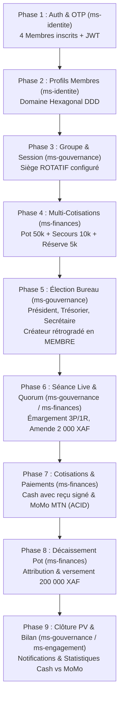

# Guide Complet des Tests d'Intégration Bout-en-Bout (E2E) — Plateforme Njangi

Ce document présente l'architecture, la procédure d'exécution et les assertions vérifiées par la suite de tests d'intégration bout-en-bout (**E2E**) de la plateforme **Njangi**.

---

## 1. Vue d'Ensemble & Objectifs

La suite E2E valide l'orchestration complète du cycle de vie d'une tontine camerounaise à travers l'**API Gateway** (`http://localhost:9090`), en vérifiant :
- La ségrégation stricte des **4 schémas PostgreSQL** (`identite`, `gouvernance`, `finances`, `engagement`).
- Le routage dynamique Eureka vers les **4 microservices métier consolidés** (`ms-identite`, `ms-gouvernance`, `ms-finances`, `ms-engagement`) tout en conservant les préfixes REST `/api/v1/*`.
- L'émission et la consommation des événements sur le **contrat Kafka unifié** (`identite.events`, `gouvernance.events`, `finances.events`, `engagement.events`) en mode **KRaft**.
- La conformité aux directives de [GEMINI.md](./GEMINI.md) (montants `XAF` sans décimales, wrapper `ApiResponse<T>`, `ProblemDetail` RFC 9457, sécurité JWT, traçabilité financière immuable).
- Les règles métier camerounaises de [cahier_des_charges_tontine.md](./cahier_des_charges_tontine.md) (démotion du créateur, quorum, amende disciplinaire, preuve cash signée obligatoire).

---

## 2. Cartographie Chronologique des 9 Phases



---

## 3. Prérequis & Démarrage de l'Infrastructure Docker

Avant d'exécuter la suite de tests, démarrez PostgreSQL (4 schémas isolés), Kafka KRaft et Eureka Server :

```powershell
.\scripts\start-docker-infra.ps1
```

Ports d'infrastructure attendus :
- `5432` : PostgreSQL 16
- `9092` : Kafka KRaft
- `8761` : Netflix Eureka Discovery Server
- `9090` : API Gateway (`api-gateway`)
- `8001`–`8004` : `ms-identite`, `ms-gouvernance`, `ms-finances`, `ms-engagement`

---

## 4. Exécution du Script Interactif PowerShell

Le script [scripts/test-e2e-scenario.ps1](./scripts/test-e2e-scenario.ps1) orchestre automatiquement les 9 phases avec extraction dynamique des tokens JWT et assertions pas-à-pas :

```powershell
# Exécution standard via l'API Gateway (Port 9090 — Recommandé)
.\scripts\test-e2e-scenario.ps1

# Exécution avec URL Gateway personnalisée
.\scripts\test-e2e-scenario.ps1 -GatewayUrl "http://localhost:9090"
```

---

## 5. Exécution Automatisée via Postman & Newman (CI/CD)

```bash
npm install -g newman

npx newman run postman/njangi-e2e.postman_collection.json \
    -e postman/njangi-e2e.postman_environment.json \
    --reporters cli,json \
    --reporter-json-export reports/e2e-results.json
```

---

## 6. Matrice des Assertions Métier Validées

| Règle Métier | Service Cible | Route Gateway | Assertion Validée |
|---|---|---|---|
| **SSO, OTP & Téléphone E.164** | `ms-identite` | `/api/v1/auth/**` | Normalisation `+237...` / diaspora, BCrypt, émission et validation JWT |
| **Domaine Hexagonal Pur** | `ms-identite` | `/api/v1/membres/**` | Profils membres et rôles par groupe sans dépendance Spring/JPA dans `domain/` |
| **Siège Fixe vs Rotatif** | `ms-gouvernance` | `/api/v1/groupes/**` | Type de siège tournant persisté avec adresse chez l'hôte de séance |
| **Démotion du Créateur** | `ms-gouvernance` | `/api/v1/groupes/{id}/bureau` | Dès l'élection du premier bureau, le rôle du créateur devient `MEMBRE` |
| **Conduite de Séance & Quorum** | `ms-gouvernance` | `/api/v1/reunions/**` | Émargement par lot, calcul du quorum et archivage du PV officiel |
| **Multi-Cotisations Simultanées** | `ms-finances` | `/api/v1/cotisations/**` | Définition distincte du Pot rotatif, Secours et Caisse de réserve |
| **Discipline & Sanctions** | `ms-finances` | `/api/v1/penalites/**` | Résolution du barème de retard et amende infligée au membre défaillant |
| **Preuve Cash & Mobile Money (ACID)** | `ms-finances` | `/api/v1/paiements/**` | Rejet cash sans reçu signé, clé d'idempotence MoMo, mise à jour atomique de la cotisation |
| **Décaissement du Pot** | `ms-finances` | `/api/v1/cotisations/pots/**` | Montant total (ex. `200 000 XAF`) attribué et décaissé avec décharge archivée |
| **Notifications & Bilan Consolidé** | `ms-engagement` | `/api/v1/notifications/**`, `/api/v1/statistiques/**` | Diffusion multi-canaux et ventilation stricte `totalCash` vs `totalMomo` via Kafka |
